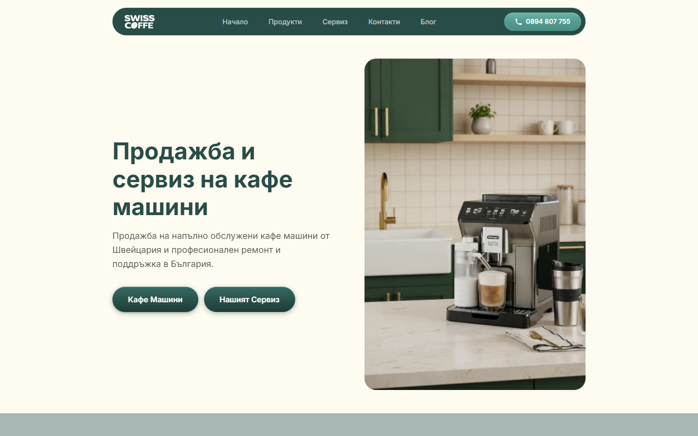
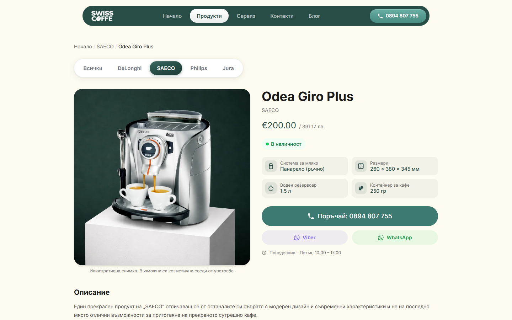
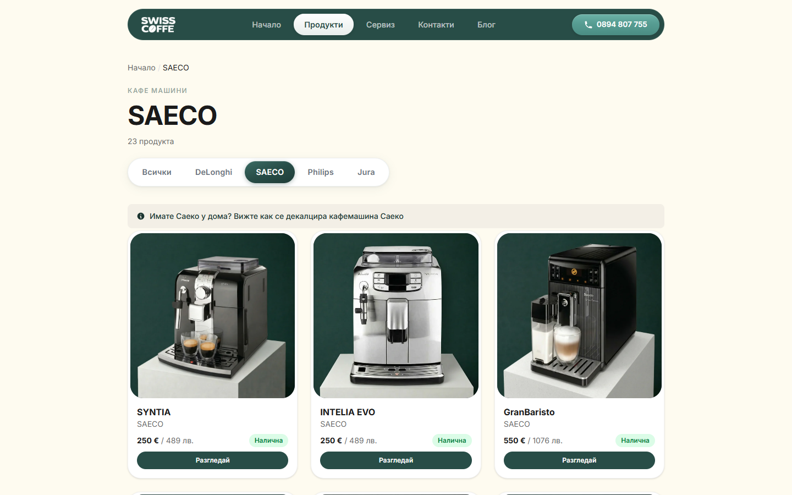
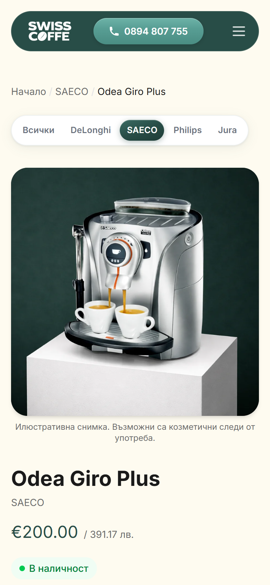

# kafemashini.ch: WordPress to Astro migration + AI-assisted SEO system

**Live site: [kafemashini.ch](https://kafemashini.ch)** · Bulgarian e-commerce catalog for refurbished Swiss coffee machines (Saeco, DeLonghi, Jura, Philips) with an in-house repair service.

Published with the owner's permission. This is the production source code. Business strategy, analytics exports, and internal notes are kept private.

| Before (WordPress, untouched since 2017) | After (Astro, live since March 2026) |
|---|---|
|  |  |

## The brief

The shop ran on a WordPress theme that hadn't been updated since 2017. The catalog was full of products that had sold years earlier, the content was thin, and the design looked like the decade it came from. The owner wanted a modern site that sells and ranks without becoming a maintenance burden for a small business.

I owned the whole project end to end: architecture, migration, design, build, deployment, and the SEO system that keeps growing the site after launch.

## 1. Architecture decisions

| Decision | Why |
|---|---|
| **Astro, static output** | A catalog doesn't need a server. Pre-rendered HTML is the fastest page you can serve, has no attack surface to patch, and nothing breaks between visits. |
| **Cloudflare Pages** | Global CDN, free tier, deploys on every `git push`, edge-level HTTP→HTTPS and redirects. |
| **JSON data layer instead of a CMS** | 63 products don't justify a database. `data/products.json` is versioned, diffable, validated at build time, and editable by the AI tooling. |
| **Tailwind CSS v4 + vanilla JS** | No front-end framework shipped to the browser. Interactivity (gallery, mobile nav, cookie consent) is a few hundred lines of plain JS. |
| **Content collections for the blog** | Typed frontmatter (`src/content.config.ts`) means every article must declare its keyword, cluster, FAQ, and related products, or the build fails. |
| **SEO in the template, not in plugins** | Canonicals, Open Graph, and JSON-LD are generated per page type by `SEOHead.astro`, so a new product or article can't ship without them. |

## 2. Migration

- **Scraped the legacy site** into structured data with custom Node scripts (`tools/scrape-*.mjs`): products, categories, specs, info pages, images.
- **Cleaned and enriched the catalog**: retired sold-out stock, extracted specs buried in free-text descriptions (`extract-embedded-specs.mjs`, `merge-enriched-specs.mjs`), validated every entry (`validate-data.mjs`).
- **Optimized every image** with Sharp (`optimize-images.mjs`).
- **Preserved search equity**: built a URL inventory of every legacy URL Google knew about (113 rows) and mapped each to a destination. **81 permanent redirects** in `public/_redirects`, verified with `verify-urls.mjs`, designed around Cloudflare's rule constraints (one wildcard per rule, static-before-dynamic precedence).

## 3. Design

A new visual identity built from scratch: deep green and cream palette, Inter variable font, rounded card system, mobile-first layouts. Prices show in EUR and BGN for the Bulgarian market. All copy, alt text, and schema labels are in Bulgarian.

| Product page | Category page | Mobile |
|---|---|---|
|  |  |  |

## 4. AI-assisted SEO analysis and growth system

A content and technical-SEO pipeline that runs on Claude Code. **AI does the drafting, linking, validation, and publishing. The owner approves every article before it ships**, which keeps the shop's real expertise and voice in the content and keeps generic AI filler out.

### The content engine (`.claude/skills/seo-engine/SKILL.md`)

Three commands drive the whole loop:

- **`/seo-engine next`** picks the next topic from the content calendar, writes a brief, and drafts a full Bulgarian article with frontmatter, FAQ, and internal links. Anything only the shop can know (prices, turnaround times) is left as an `⟨OWNER: …⟩` marker instead of being made up. Drafting stops by itself if two drafts are already waiting for review.
- **`/seo-engine publish <slug>`** diffs the owner's edits against the original draft and records the corrections in a brand-voice log, so **each draft starts closer to the owner's voice than the last**. It then converts the draft into a post, enforces the internal-linking rules, builds, verifies, and deploys.
- **`/seo-engine status`** reports the queue, pending drafts, and link-graph health.

### Supporting tools

| Tool | What it does |
|---|---|
| `tools/kw_suggest.py` | **Keyword-demand gate.** Probes Google Autocomplete (pinned to Bulgarian locale and geo) to confirm real search demand *before* an article is written. Costs $0 and takes about 20 seconds. It exists because an early draft was written against a topic with zero demand. Now no article is drafted without passing this check. |
| `tools/link_graph.py` | **Internal-link graph.** Parses the production build and reports broken links, links that hit redirects, and orphan pages (pages with no contextual inbound links). CI-friendly exit codes. Current state: **0 / 0 / 0**. |
| `tools/seo-api/` | **Analytics layer.** Python clients for the Google Search Console (queries + URL inspection), GA4, and Chrome UX Report APIs, so traffic and indexing analysis is scripted and repeatable instead of manual dashboard work. |

### Structured data at scale

Every page ships valid JSON-LD, generated from data:

| Schema | Pages |
|---|---|
| `Product` + `Offer` | 63 |
| `FAQPage` | 66 |
| `BreadcrumbList` | 79 |
| `Store` (local business, hours, geo) | sitewide |
| `Article` | every blog post |

### Results

- The first engine-produced article reached **490 impressions and 28 clicks at average position 4.6** within about six weeks of publishing, **5.6x more clicks than the site's main service page** it was written to support.
- Around 78% of that article's impressions came from long-tail queries too rare for Search Console to even name. Optimizing for head keywords alone would never have found that traffic.
- The build ships with **zero broken internal links, zero redirect-hitting links, and zero orphan pages**, all checked automatically on every publish.

## Tech stack

**Astro 6** · **Tailwind CSS v4** · TypeScript · vanilla JS · **Cloudflare Pages** · Sharp · Cheerio + Puppeteer (migration scraping) · Python (SEO tooling) · Google Search Console / GA4 / CrUX APIs · **Claude Code** (AI agent workflows)

## Repository layout

```
src/
  pages/            routes: products, brand categories, blog, service and info pages
  components/       SEOHead, product sections, cards, nav, cookie consent
  layouts/          BaseLayout (head, Organization schema, analytics), PageLayout
  content/blog/     articles produced by the SEO engine
  utils/            product queries, EUR/BGN currency
data/               products, brands, reviews, enriched specs, site config
public/_redirects   legacy URL → new URL map (Cloudflare Pages)
tools/              migration scripts, keyword gate, link graph, Google API clients
.claude/skills/     the seo-engine skill definition
```

## Run it locally

```sh
npm install
npm run dev       # http://localhost:4321
npm run build     # 80 static pages in about 5 seconds
python tools/link_graph.py --out link-map.md   # internal-link audit (run after build)
```

Requires Node 22.12+.

**Not included:** the SEO strategy and keyword research workspace that the engine reads from (`seo/`), analytics exports, and project notes. The skill file references them; they stay private to the business.

---

Built by [@tomov97](https://github.com/tomov97). Available for website migrations, Astro builds, and AI-assisted SEO automation.
